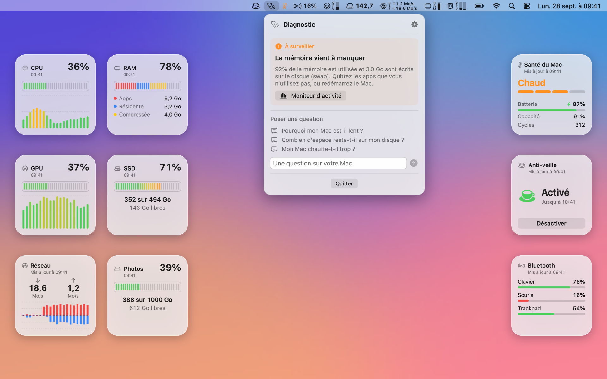
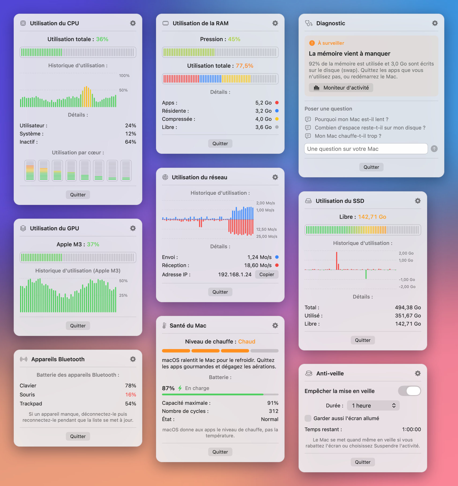
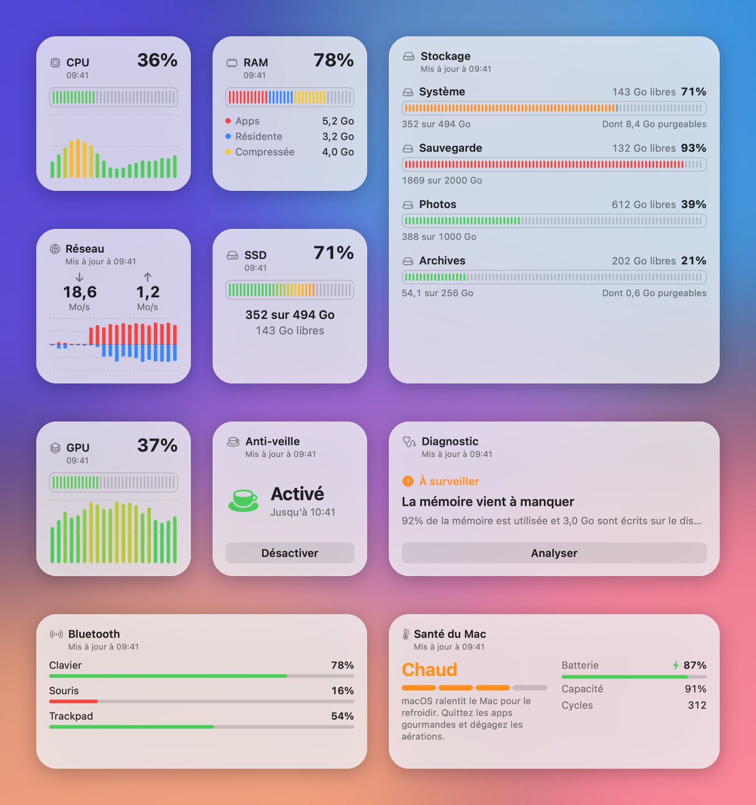

# SimplyBar

[English](README.md) | **Français**

[](https://github.com/Iliesseu28/SimplyBar/actions/workflows/ci.yml)
[](LICENSE)


https://github.com/user-attachments/assets/f5201cb8-1857-4e28-ada7-00c3b93f18bb

La démonstration en vidéo : 29 secondes, en anglais, avec le son.

Un moniteur système gratuit et open source pour la barre de menus de macOS. SimplyBar affiche d'un coup d'œil
le processeur, la mémoire, la carte graphique, le réseau, le disque et la batterie des appareils Bluetooth,
vérifie en un clic que votre Mac va bien, l'empêche de se mettre en veille quand il le faut, et ajoute dix
widgets au bureau.



## Points forts

- **Gratuit, pour de bon.** Ni publicité, ni compte, ni abonnement, ni achat intégré. Licence MIT.
- **Open source.** Chaque ligne qui tourne sur votre Mac est dans ce dépôt.
- **Confidentiel par conception.** Tourne dans le bac à sable, sans accès au réseau. Rien n'est collecté, rien ne
  quitte votre Mac, y compris le diagnostic par l'IA, qui tourne sur le Mac lui-même.
- **Dix widgets de bureau.** Processeur, mémoire, carte graphique, réseau, SSD, Stockage pour tous les disques,
  batterie Bluetooth, Santé du Mac, et deux sur lesquels on clique : Diagnostic et Anti-veille.
- **Léger.** Un module masqué n'est pas mesuré du tout. Swift et SwiftUI natifs, aucune dépendance tierce.
- **50 langues.** Toute l'interface est traduite.

## Nouveautés de la 1.1

- **Diagnostic.** Un clic dit si votre Mac va bien, s'il faut le surveiller ou s'il a un problème, et pourquoi.
  Sur macOS 26 ou plus récent avec Apple Intelligence activée, le modèle d'Apple intégré à l'appareil rédige
  l'explication et vous pouvez poser des questions sur votre Mac. Ailleurs, des règles intégrées donnent le même
  verdict. Détails [plus bas](#diagnostic).
- **Anti-veille.** Empêche le Mac de se mettre en veille, indéfiniment ou pendant 30 minutes, 1, 2 ou 4 heures, avec
  une option pour garder aussi l'écran allumé. Depuis la barre de menus ou depuis un widget en un clic.
- **Santé du Mac.** Le niveau de chauffe du Mac et, sur un portable, sa batterie : charge, capacité maximale, nombre
  de cycles et état.
- **Alertes.** Notifications locales en option quand un appareil Bluetooth est presque vide, que le disque de
  démarrage se remplit ou que le Mac chauffe.
- **Cinq nouveaux widgets.** Carte graphique, batterie Bluetooth, Santé du Mac, Diagnostic et Anti-veille.

## Ce qu'elle affiche

### Barre de menus

Activez ou masquez chaque module, et choisissez ce qu'il affiche et comment (barre, pourcentage ou gigaoctets,
selon le module).

| Module | Dans la barre de menus | Dans sa fenêtre | Affiché par défaut |
|---|---|---|---|
| CPU | Total, utilisateur, système, inactif, utilisateur + système, ou une barre par cœur | Historique, parts utilisateur, système et inactif, charge par cœur | Oui |
| RAM | Total, apps, résidente, compressée, ou pression mémoire | Historique et détail complet de la mémoire utilisée | Oui |
| GPU | Utilisation de la carte graphique | Historique, titré avec le modèle de la carte | Oui |
| Réseau | Envoi, réception, les deux, ou l'adresse IP locale | Débits montant et descendant, historique, adresse IP locale (copie en un clic) | Oui |
| SSD | Espace total, libre ou utilisé du disque de démarrage | Historique de l'espace utilisé, puis espace total, utilisé et libre | Oui |
| Bluetooth | Batterie des appareils connectés | Chaque appareil connecté, avec son niveau de batterie quand macOS le donne | Non |
| Santé | Un thermomètre qui passe au jaune, à l'orange ou au rouge quand le Mac chauffe | Niveau de chauffe (normal, tiède, chaud, critique), conseil quand il chauffe, et section Batterie sur un portable | Non |
| Diagnostic | Un stéthoscope | La carte du verdict, ses boutons, et les questions sur votre Mac | Oui |
| Anti-veille | Une tasse, pleine quand l'anti-veille est active | Interrupteur, durée, « Garder aussi l'écran allumé », temps restant | Oui |




### Diagnostic

Le module Diagnostic lit un instantané du Mac (processeur, mémoire, carte graphique, disques, chauffe, batteries,
appareils Bluetooth, réseau, temps depuis le dernier redémarrage) et rend un verdict : **OK**, **À surveiller** ou
**Problème**, avec un titre, deux phrases et jusqu'à trois boutons qui mènent au bon endroit (Moniteur d'activité,
réglages du stockage ou de la batterie, onglet Alertes, ou anti-veille pendant une heure).

Il fonctionne en couches, pour toujours répondre :

1. **Des règles, sur tous les Mac (macOS 14 ou plus récent).** Des règles intégrées fixent le verdict, le titre et
   les boutons permis. Elles n'utilisent aucune IA et sont traduites dans les 50 langues de l'app.
2. **Le modèle d'Apple intégré à l'appareil, quand il est disponible.** Sur macOS 26 ou plus récent, avec Apple
   Intelligence activée et dans une langue qu'elle prend en charge, le modèle de langage d'Apple intégré au Mac
   rédige les deux phrases et propose les boutons. La carte indique alors « Rédigé sur ce Mac par l'IA d'Apple
   intégrée à l'appareil. Rien ne quitte votre Mac. » et le widget porte une petite marque « IA ».
3. **Un contrôle de tout ce que le modèle écrit.** Son texte ne s'affiche qu'après contrôle : même verdict que les
   règles, boutons pris dans une liste fixe et dont la condition est vraie, aucun nombre absent de l'instantané. Au
   moindre écart, ou si le modèle est occupé, désactivé ou absent, c'est la carte des règles qui s'affiche.

Avec Apple Intelligence, **Poser une question** permet de discuter de votre Mac (« Pourquoi mon Mac est-il lent ? »).
Le modèle ne peut lire que les mêmes mesures, par des outils en lecture seule, une requête à la fois. Rien n'est
envoyé à un serveur : SimplyBar utilise seulement le modèle intégré à l'appareil, jamais Private Cloud Compute, et
n'a aucun accès au réseau.

### Alertes

Toutes les alertes sont coupées par défaut. macOS demande l'autorisation d'envoyer des notifications la première
fois qu'on en allume une.

| Alerte | Envoyée quand | Revient après |
|---|---|---|
| Batterie Bluetooth | Un appareil descend à 20 % ou moins | Retour à 25 % |
| Disque de démarrage | Moins de 10 % du disque est libre | Retour à 12 % libres |
| Chauffe du Mac | Le Mac est chaud, puis de nouveau s'il devient critique | Retour à normal ou tiède |

Chaque alerte est envoyée au plus une fois par heure.

### Widgets de bureau

| Widget | Tailles | Affiche |
|---|---|---|
| CPU | Petite | Charge du processeur et son historique récent |
| RAM | Petite | Mémoire utilisée et sa répartition : apps, résidente, compressée |
| GPU | Petite | Charge de la carte graphique et son historique récent |
| Réseau | Petite | Débits descendant et montant avec leur historique récent |
| SSD | Petite | Espace utilisé et libre du disque de démarrage |
| Stockage | Petite, moyenne, grande | Espace utilisé, libre et purgeable de chaque disque, disques externes compris ; la petite taille montre le disque choisi |
| Bluetooth | Petite, moyenne | Niveau de batterie des appareils Bluetooth |
| Santé du Mac | Petite, moyenne | Niveau de chauffe du Mac, et sa batterie sur un portable |
| Diagnostic | Petite, moyenne | Le dernier verdict, avec un bouton **Analyser** |
| Anti-veille | Petite | Un bouton pour activer ou couper l'anti-veille |

Les widgets lisent les valeurs que l'app écrit dans son conteneur partagé (App Group) : laissez SimplyBar
tourner pour qu'ils se mettent à jour. WidgetKit les rafraîchit environ toutes les 30 minutes, et un widget
qu'on vient de poser peut attendre jusqu'à 5 minutes ses premiers chiffres. Chaque widget affiche l'heure de sa
dernière mesure. Les boutons des widgets Diagnostic et Anti-veille demandent à l'app ouverte d'agir, et le widget
affiche le résultat.



## Limites connues

Elles viennent de macOS, pas d'une fonction oubliée :

- **Ni températures, ni vitesse des ventilateurs.** Les capteurs qui les donnent sont fermés aux apps du bac à
  sable, obligatoire pour toute app du Mac App Store. macOS donne à la place un niveau de chauffe, que le module
  Santé affiche.
- **Pas de niveau de batterie pour les casques et écouteurs sans fil.** macOS ne le donne pas aux apps du
  Mac App Store. Ils apparaissent quand même comme connectés dans la liste Bluetooth. Les claviers, souris et
  trackpads Apple, et les accessoires que macOS liste comme sources d'alimentation, affichent bien leur batterie.
- **L'espace libre est légèrement arrondi vers le bas.** Dans le bac à sable, macOS arrondit la capacité
  disponible d'un disque.
- **L'anti-veille ne l'emporte pas sur l'écran rabattu.** Rabattre l'écran d'un portable ou choisir « Suspendre
  l'activité » met quand même le Mac en veille. L'anti-veille ne reste pas active quand on relance l'app.
- **La partie IA du Diagnostic demande macOS 26 et Apple Intelligence.** Sans eux, ou dans une langue qu'Apple
  Intelligence ne prend pas encore en charge, la carte des règles s'affiche et les questions ne sont pas
  disponibles.

## Installation

- **Mac App Store :** bientôt disponible.
- **Depuis le code source :** voir plus bas. L'app tourne sur macOS 14 Sonoma ou plus récent (binaire universel
  pour Apple silicon et Intel). Sa compilation demande Xcode 26.6 ou plus récent : la CI vérifie chaque
  changement avec Xcode 26.6 et Xcode 27.

## Compiler et tester

Clonez le dépôt, puis lancez les tests depuis le dossier du projet. La signature est désactivée en ligne de
commande : ni compte développeur Apple, ni certificat ne sont nécessaires.

```sh
git clone https://github.com/Iliesseu28/SimplyBar.git
cd SimplyBar
xcodebuild test \
  -project SimplyBar.xcodeproj \
  -scheme SimplyBar \
  -destination 'platform=macOS' \
  CODE_SIGNING_ALLOWED=NO CODE_SIGNING_REQUIRED=NO CODE_SIGN_IDENTITY=""
```

La commande se termine par `** TEST SUCCEEDED **`. La même tourne dans la CI à chaque push et à chaque pull
request ([workflow](.github/workflows/ci.yml)). Les tests qui ont besoin du modèle d'Apple intégré à l'appareil
sont sautés sur un Mac qui ne l'a pas.

Pour compiler l'app elle-même en Release, toujours sans signature :

```sh
xcodebuild build \
  -project SimplyBar.xcodeproj \
  -scheme SimplyBar \
  -configuration Release \
  -destination 'platform=macOS' \
  CODE_SIGNING_ALLOWED=NO CODE_SIGNING_REQUIRED=NO CODE_SIGN_IDENTITY=""
```

### La lancer sur votre Mac

La compilation sans signature prouve que le code compile. Pour lancer l'app avec ses widgets, signez-la avec
votre propre équipe :

1. Ouvrez `SimplyBar.xcodeproj` dans Xcode.
2. Dans **Signing & Capabilities**, choisissez votre équipe pour les cibles `SimplyBar` et `SimplyBarWidgets`.
3. L'identifiant de l'App Group commence par l'identifiant d'équipe. Remplacez `ZNPYGQCK98` par le vôtre dans
   `SimplyBar/SimplyBar.entitlements`, `SimplyBarWidgets/SimplyBarWidgets.entitlements` et
   `Shared/SharedStore.swift`. Ne commitez pas ce changement.
4. Lancez le schéma `SimplyBar`. L'app vit dans la barre de menus et n'a pas d'icône dans le Dock.

Si l'app, placée dans le bac à sable, se ferme juste après son lancement depuis un disque externe, copiez
`SimplyBar.app` dans `/Applications` et ouvrez-la depuis là.

## Architecture

| Dossier | Rôle | Cibles |
|---|---|---|
| `Shared/` | Modèles, formats des nombres, graphiques, fichier partagé avec les widgets, String Catalog | App, widgets, tests |
| `Core/` | Lectures système : CPU (`host_processor_info`), mémoire (`host_statistics64`), disque (`volumeAvailableCapacityForImportantUsage`), réseau (`getifaddrs`), GPU (IOKit `IOAccelerator`), Bluetooth (IOKit, sources d'alimentation, Core Audio), disques du widget Stockage (`getfsstat` et IOKit), chauffe et batterie (`ProcessInfo.thermalState`, sources d'alimentation, `AppleSmartBattery`), assertions d'alimentation de l'anti-veille (`IOPMAssertionCreateWithName`), règles des alertes, et le Diagnostic (instantané, règles, modèle intégré à l'appareil, contrôles) | App, tests |
| `SimplyBar/` | L'app : réglages, minuteries de mesure, éléments de la barre de menus, fenêtres détaillées, fenêtre de réglages, anti-veille, notifications, pilotage du Diagnostic | App |
| `SimplyBarWidgets/` | Extension WidgetKit. Elle lit le fichier partagé et ne mesure rien elle-même. Les boutons Diagnostic et Anti-veille transmettent la demande à l'app ; l'extension ne charge jamais le modèle de langage | Widgets |
| `SimplyBarTests/` | Suites Swift Testing : formats, pourcentages, calculs CPU, mémoire, réseau et Bluetooth, anti-veille, santé, alertes, règles et contrôles du Diagnostic, lecteurs réels | Tests |

- Swift 6 en concurrence stricte : vues et état sur le main actor, lecteurs `nonisolated`.
- Aucun paquet tiers. Uniquement les frameworks du SDK de macOS. `FoundationModels` est lié en faible : l'app se
  lance toujours sur macOS 14 et 15.
- Un module ni affiché ni ouvert n'est pas mesuré. Un module qui n'alimente qu'un widget est mesuré une fois par minute.
- Les textes sont dans des String Catalogs (`Shared/Localizable.xcstrings`, `SimplyBar/InfoPlist.xcstrings`).

## Confidentialité

- **Aucune donnée collectée.** Ni statistiques d'usage, ni rapport de plantage, ni compte. Voir
  [la politique de confidentialité](https://simplibot.fr/simplybar/confidentialite).
- **Aucun accès au réseau.** L'app et ses widgets n'ont pas le droit d'accès au réseau : ils ne peuvent se
  connecter à rien. Le module Réseau compte seulement les octets de vos propres interfaces.
- **IA sur l'appareil uniquement.** Le Diagnostic utilise le modèle de langage d'Apple intégré au Mac. Vos mesures
  et vos questions restent sur votre Mac.
- **Bac à sable.** L'app et ses widgets partagent seulement un conteneur App Group sur votre Mac, qui sert à
  transmettre les dernières valeurs aux widgets et les demandes de leurs boutons à l'app. Les réglages restent
  dans les préférences de l'app.
- **Notifications** locales, envoyées par votre Mac, et seulement pour les alertes que vous allumez.
- **Manifestes de confidentialité** (`PrivacyInfo.xcprivacy`) : aucun pistage, aucune donnée collectée.

## Liens

- Site : <https://simplibot.fr/simplybar>
- Politique de confidentialité : <https://simplibot.fr/simplybar/confidentialite>
- Assistance : <https://simplibot.fr/simplybar/support>

## Contribuer

Signalements de bugs, idées et pull requests sont les bienvenus. Lisez d'abord [CONTRIBUTING.md](CONTRIBUTING.md)
(en anglais) : le bac à sable, l'absence d'accès au réseau et l'absence de dépendance tierce sont des règles
fermes. Pour signaler une faille de sécurité en privé, voir [SECURITY.md](SECURITY.md).

## Licence

SimplyBar est distribuée sous [licence MIT](LICENSE). Copyright (c) 2026 Simplibot.
