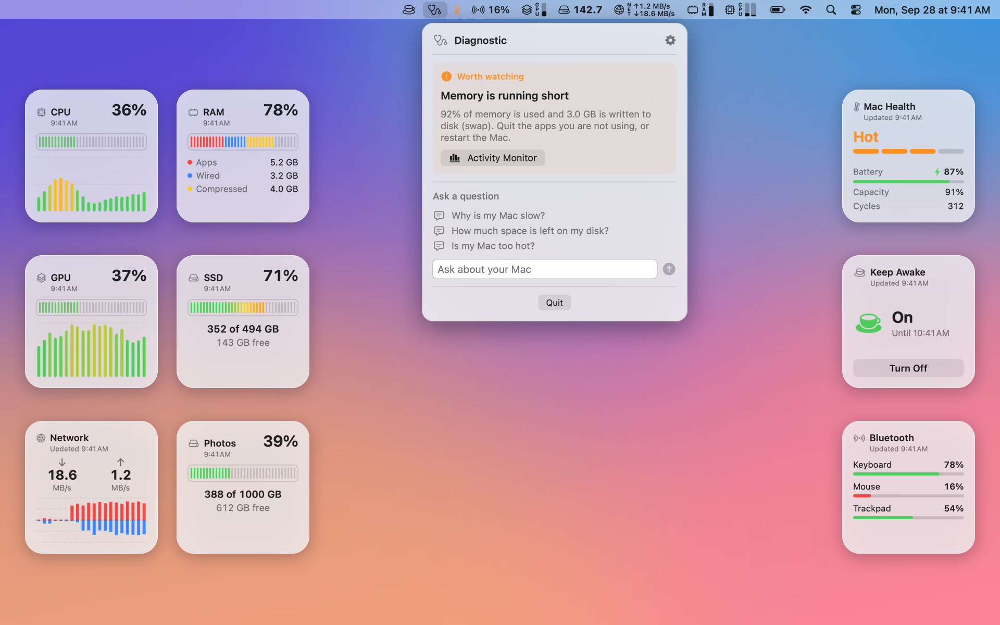
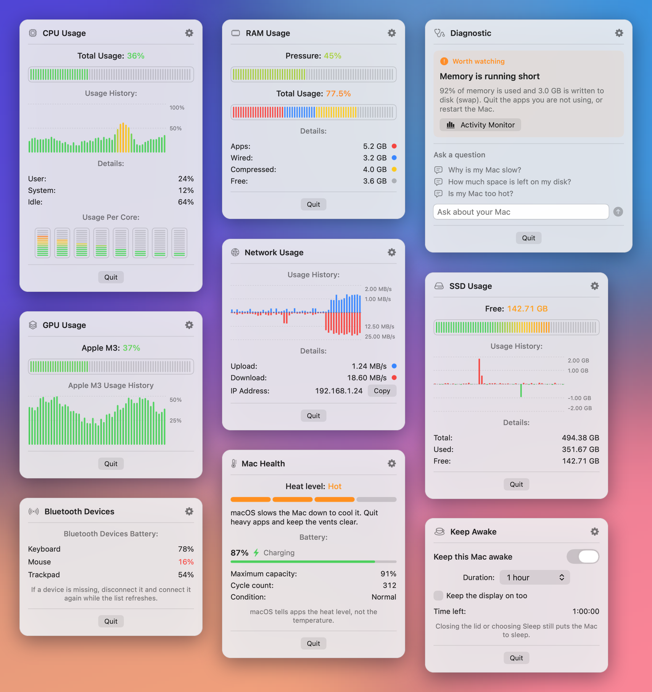
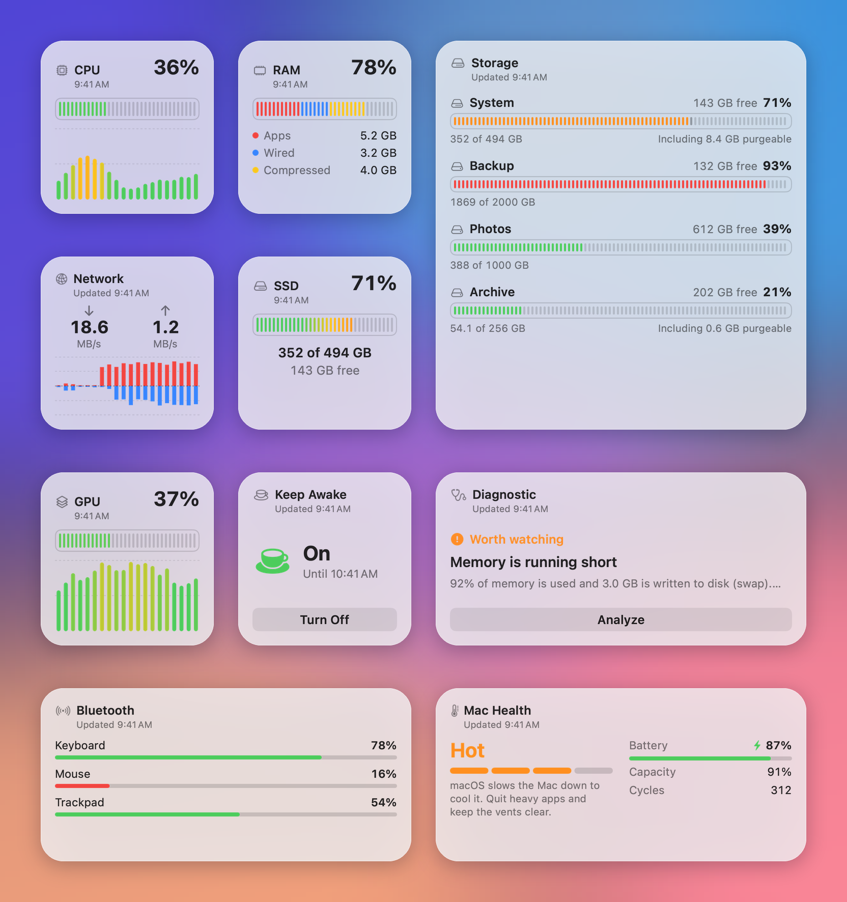

# SimplyBar

**English** | [Français](README.fr.md)

[](https://github.com/Iliesseu28/SimplyBar/actions/workflows/ci.yml)
[](LICENSE)


https://github.com/user-attachments/assets/f5201cb8-1857-4e28-ada7-00c3b93f18bb

See it in action in 29 seconds, with sound.

A free and open source system monitor for the macOS menu bar. SimplyBar shows CPU, memory, GPU, network, disk
and Bluetooth battery levels at a glance, checks how your Mac is doing in one click, keeps it awake when you
need it, and adds ten widgets to your desktop.



## Highlights

- **Free, for good.** No ads, no account, no subscription, no in-app purchase. MIT licensed.
- **Open source.** Every line that runs on your Mac is in this repository.
- **Private by design.** Runs in the App Sandbox with no network access. Nothing is collected, nothing leaves your Mac,
  and that includes the AI diagnostic, which runs on the Mac itself.
- **Ten desktop widgets.** CPU, RAM, GPU, Network, SSD, Storage for every disk, Bluetooth battery, Mac Health,
  plus two you can click: Diagnostic and Keep Awake.
- **Light.** A module you hide is not measured at all. Native Swift and SwiftUI, no third-party dependency.
- **50 languages.** The whole interface is translated.

## New in 1.1

- **Diagnostic.** One click tells you whether your Mac is fine, worth watching, or has a problem, and why. On
  macOS 26 or later with Apple Intelligence turned on, Apple's on-device model writes the explanation and you can
  ask questions about your Mac. Elsewhere, built-in rules give the same verdict. Details [below](#diagnostic).
- **Keep Awake.** Stop your Mac from going to sleep, indefinitely or for 30 minutes, 1, 2 or 4 hours, with an option
  to keep the display on too. Available from the menu bar and from a one-click widget.
- **Mac Health.** The heat level of your Mac and, on a laptop, its battery: charge, maximum capacity, cycle count
  and condition.
- **Alerts.** Optional local notifications when a Bluetooth device runs low, the startup disk fills up, or the Mac
  gets hot.
- **Five new widgets.** GPU, Bluetooth battery, Mac Health, Diagnostic and Keep Awake.

## What it shows

### Menu bar

Turn each module on or off, and choose what it displays and how (bar, percentage or gigabytes, depending on the module).

| Module | In the menu bar | In its popup | Shown by default |
|---|---|---|---|
| CPU | Total, user, system, idle, user + system, or one bar per core | Usage history, user, system and idle shares, usage per core | Yes |
| RAM | Total, apps, wired, compressed, or memory pressure | Usage history and the full breakdown of used memory | Yes |
| GPU | GPU usage | Usage history, titled with the GPU model | Yes |
| Network | Upload, download, both, or the local IP address | Upload and download speeds, history, local IP address (one click to copy) | Yes |
| SSD | Total, free or used space of the startup disk | History of the space used, then total, used and free space | Yes |
| Bluetooth | Battery of your connected devices | Every connected device, with its battery level when macOS reports one | No |
| Health | A thermometer that turns yellow, orange or red as the Mac heats up | Heat level (normal, warm, hot, critical), advice when it runs hot, and the battery section on a laptop | No |
| Diagnostic | A stethoscope | The verdict card, its buttons, and questions about your Mac | Yes |
| Keep Awake | A cup, full while it is on | On/off switch, duration, "Keep the display on too", time left | Yes |




### Diagnostic

The Diagnostic module reads a snapshot of the Mac (processor, memory, GPU, disks, heat, batteries, Bluetooth
devices, network, time since the last restart) and gives a verdict: **OK**, **Worth watching** or **Problem**,
with a title, two sentences and up to three buttons that take you to the right place (Activity Monitor, storage
or battery settings, the Alerts tab, or Keep Awake for one hour).

It works in layers, so it always answers:

1. **Rules, on every Mac (macOS 14 or later).** Built-in rules set the verdict, the title and the allowed buttons.
   They need no AI and are translated into the 50 languages of the app.
2. **Apple's on-device model, when available.** On macOS 26 or later, with Apple Intelligence turned on and in a
   language it supports, Apple's on-device language model writes the two sentences and suggests the buttons. The
   card then reads "Written on this Mac by Apple's on-device AI. Nothing leaves your Mac." and the widget shows a
   small "AI" mark.
3. **A check on everything the model writes.** Its text is shown only after it passes: same verdict as the rules,
   buttons from a fixed list whose condition is true, and no number that is not in the snapshot. If anything
   fails, or the model is busy, turned off or missing, you get the rules card instead.

With Apple Intelligence, **Ask a question** lets you chat about your Mac ("Why is my Mac slow?"). The model can
only read the same measurements, through read-only tools, one request at a time. Nothing is sent to a server:
SimplyBar uses only the on-device model, never Private Cloud Compute, and has no network access at all.

### Alerts

All alerts are off by default. macOS asks for permission to send notifications the first time you turn one on.

| Alert | Sent when | Comes back after |
|---|---|---|
| Bluetooth battery | A device drops to 20% or less | It is back to 25% |
| Startup disk | Less than 10% of the disk is free | 12% is free again |
| Mac heat | The Mac is hot, then again if it becomes critical | It is back to normal or warm |

Each alert is sent at most once an hour.

### Desktop widgets

| Widget | Sizes | Shows |
|---|---|---|
| CPU | Small | CPU load and its recent history |
| RAM | Small | Memory in use and how it splits: apps, wired, compressed |
| GPU | Small | GPU load and its recent history |
| Network | Small | Download and upload speeds with their recent history |
| SSD | Small | Used and free space of the startup disk |
| Storage | Small, medium, large | Used, free and purgeable space on every disk, external drives included; the small size shows the disk you pick |
| Bluetooth | Small, medium | Battery levels of your Bluetooth devices |
| Mac Health | Small, medium | Heat level of the Mac, and its battery on a laptop |
| Diagnostic | Small, medium | The latest verdict, with an **Analyze** button |
| Keep Awake | Small | One button to turn Keep Awake on or off |

Widgets read the values the app writes to its shared App Group container: keep SimplyBar running for them to
update. WidgetKit refreshes them about every 30 minutes, and a widget you have just added can wait up to
5 minutes for its first numbers. Each widget shows the time of its last reading. The Diagnostic and Keep Awake
buttons ask the running app to act, and the widget shows the result.



## Known limits

These come from macOS, not from a missing feature:

- **No temperatures and no fan speeds.** The sensors that report them are closed to apps in the App Sandbox,
  which every Mac App Store app must use. macOS gives apps a heat level instead, which the Health module shows.
- **No battery level for wireless headphones and earbuds.** macOS does not give it to Mac App Store apps.
  They still appear in the Bluetooth list as connected. Apple keyboards, mice and trackpads, and accessories
  that macOS lists as power sources, do show their battery.
- **Free space is rounded down slightly.** Inside the App Sandbox, macOS rounds the available capacity of a disk.
- **Keep Awake does not override a closed lid.** Closing a laptop lid or choosing Sleep still puts the Mac to sleep.
  Keep Awake is not kept on when you relaunch the app.
- **The AI part of the Diagnostic needs macOS 26 and Apple Intelligence.** Without them, or in a language Apple
  Intelligence does not support yet, the rules card is shown and questions are not available.

## Install

- **Mac App Store:** coming soon.
- **From the source code:** see below. The app runs on macOS 14 Sonoma or later (universal build for Apple silicon
  and Intel). Building it takes Xcode 26.6 or later: CI checks every change with Xcode 26.6 and Xcode 27.

## Build and test

Clone the repository, then run the tests from the project folder. Code signing is turned off on the command
line, so no Apple developer account and no certificate are needed:

```sh
git clone https://github.com/Iliesseu28/SimplyBar.git
cd SimplyBar
xcodebuild test \
  -project SimplyBar.xcodeproj \
  -scheme SimplyBar \
  -destination 'platform=macOS' \
  CODE_SIGNING_ALLOWED=NO CODE_SIGNING_REQUIRED=NO CODE_SIGN_IDENTITY=""
```

The run ends with `** TEST SUCCEEDED **`. The same command runs in CI on every push and pull request
([workflow](.github/workflows/ci.yml)). Tests that need Apple's on-device model are skipped on a Mac without it.

To compile the app itself in Release, still without signing:

```sh
xcodebuild build \
  -project SimplyBar.xcodeproj \
  -scheme SimplyBar \
  -configuration Release \
  -destination 'platform=macOS' \
  CODE_SIGNING_ALLOWED=NO CODE_SIGNING_REQUIRED=NO CODE_SIGN_IDENTITY=""
```

### Run it on your Mac

The unsigned build proves that the code compiles. To run the app with its widgets, sign it with your own team:

1. Open `SimplyBar.xcodeproj` in Xcode.
2. In **Signing & Capabilities**, choose your team for the `SimplyBar` and `SimplyBarWidgets` targets.
3. The App Group identifier starts with the team ID. Replace `ZNPYGQCK98` with your own team ID in
   `SimplyBar/SimplyBar.entitlements`, `SimplyBarWidgets/SimplyBarWidgets.entitlements` and
   `Shared/SharedStore.swift`. Do not commit this change.
4. Run the `SimplyBar` scheme. The app lives in the menu bar and has no Dock icon.

If the sandboxed app quits right after launch from an external drive, copy `SimplyBar.app` to `/Applications`
and open it from there.

## Architecture

| Folder | Role | Targets |
|---|---|---|
| `Shared/` | Models, number formats, charts, the file shared with the widgets, the String Catalog | App, widgets, tests |
| `Core/` | System readers: CPU (`host_processor_info`), memory (`host_statistics64`), disk (`volumeAvailableCapacityForImportantUsage`), network (`getifaddrs`), GPU (IOKit `IOAccelerator`), Bluetooth (IOKit, power sources, Core Audio), disks of the Storage widget (`getfsstat` and IOKit), heat and battery (`ProcessInfo.thermalState`, power sources, `AppleSmartBattery`), Keep Awake power assertions (`IOPMAssertionCreateWithName`), alert rules, and the Diagnostic (snapshot, rules, on-device model, checks) | App, tests |
| `SimplyBar/` | The app: settings, sampling timers, menu bar items, popups, settings window, Keep Awake, notifications, Diagnostic controller | App |
| `SimplyBarWidgets/` | WidgetKit extension. It reads the shared file and measures nothing itself. The Diagnostic and Keep Awake buttons hand the request to the app; the extension never loads the language model | Widgets |
| `SimplyBarTests/` | Swift Testing suites: formats, percentages, CPU, memory, network and Bluetooth math, Keep Awake, health, alerts, Diagnostic rules and checks, real readers | Tests |

- Swift 6 with strict concurrency: views and state on the main actor, readers `nonisolated`.
- No third-party package. Frameworks from the macOS SDK only. `FoundationModels` is weak-linked, so the app still
  launches on macOS 14 and 15.
- A module that is neither shown nor open is not measured. A module that only feeds a widget is measured once a minute.
- Texts live in String Catalogs (`Shared/Localizable.xcstrings`, `SimplyBar/InfoPlist.xcstrings`).

## Privacy

- **No data collected.** No analytics, no crash reporter, no account. See
  [the privacy policy](https://simplibot.fr/simplybar/confidentialite).
- **No network access.** The app and its widgets do not have the network entitlement: they cannot connect to
  anything. The network module only counts the bytes of your own interfaces.
- **On-device AI only.** The Diagnostic uses Apple's on-device language model. Your measurements and questions stay
  on your Mac.
- **App Sandbox.** The app and its widgets only share an App Group container on your Mac, used to pass the latest
  values to the widgets and the widget button requests to the app. Settings stay in the app's own preferences.
- **Notifications** are local, sent by your Mac, and only for the alerts you turn on.
- **Privacy manifests** (`PrivacyInfo.xcprivacy`) declare no tracking and no collected data.

## Links

- Website: <https://simplibot.fr/simplybar>
- Privacy policy: <https://simplibot.fr/simplybar/confidentialite>
- Support: <https://simplibot.fr/simplybar/support>

## Contributing

Bug reports, ideas and pull requests are welcome. Read [CONTRIBUTING.md](CONTRIBUTING.md) first: the App Sandbox,
no network access and no third-party dependency are firm rules. To report a security issue privately, see
[SECURITY.md](SECURITY.md).

## License

SimplyBar is released under the [MIT License](LICENSE). Copyright (c) 2026 Simplibot.
